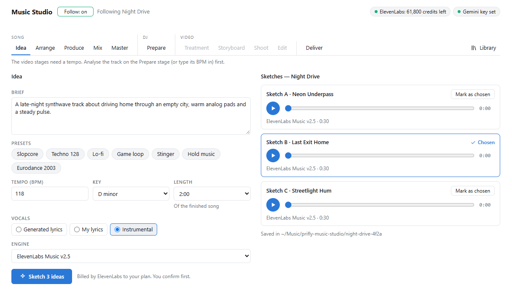

# Music Studio for prifly



_The Idea stage: a brief on the left, three 30-second sketches to play and choose from on the right (invented song and numbers)._

Take a song idea to three 30-second sketches with ElevenLabs Music v2.5 or Lyria 3 Clip, keep them in a library, and (in later versions) arrange, mix, master and film it.

This is slice 1: the foundation and the Idea stage.

- **Music Studio session** (status bar button): clicking it goes to your Music Studio session, or starts one, and shows the studio in its App tab beside the chat (Library first, or the last project; needs a prifly with session views, else the tools still work). The studio has the stage bar (Song, DJ, Video, Deliver), the Idea stage and the Library. Only Idea and the Library work; the other tabs are there, disabled, and say which later version brings them.
- **Sketch 3 ideas** shows one confirm card with the estimated cost, then makes three sketches you can play and mark as chosen.
- **Session tools**: `music_sketch` (paid, confirm card first), `music_library` (read-only list with file paths) and `music_choose` (free: marks sketch a, b or c as chosen; `music_arrange` also takes a `sketch` argument that does the same first).

## Video stages

Treatment (concept, look, cast, budget), Storyboard (shot list on the beatgrid, frames), Shoot (clips with Gemini Omni Flash, takes, budget stop), Edit (timeline in bars, transitions, speed ramps, karaoke captions, 540p preview, 1080p render) and Deliver's music video and 9:16 vertical cut. They need a tempo from Prepare and a Gemini key on a paid tier. Dollar figures are estimates from Google's price page (`video/constants.ts`). Session tools: `video_treatment`, `video_storyboard`, `video_shoot`, `video_edit`, `video_render` (`mode: "plan"` writes a job folder with the ffmpeg argv for a rented box). Shots are at most 15 seconds, the longest Omni clip, so each shot is one call.

## Setup

1. Link this folder into `~/.local/share/prifly/extensions/music-studio` and enable Music Studio in Settings → Extensions.
2. Enter an ElevenLabs key and a Gemini key there (secret fields, kept in the extension's own sealed store, never in the vault).
3. Open the Music Studio panel. Projects are saved under the library folder (default `~/Music/prifly-music-studio`) as `<slug>-<id>/brief.json` and `sketches/<a|b|c>.mp3` with a `.json` beside each.

## Development

```
bun install
bun test
bun run check
bun run typecheck
bun run build:panel   # after any change in panel/src or project/brief.ts
```

The page is TypeScript in `panel/src`, bundled with `Bun.build` into the committed `panel/app.js` (prifly installs extensions with `--ignore-scripts`). A test fails when the committed bundle is stale.

Licence: FSL-1.1-ALv2 (see LICENSE.md); contributions are under the CLA.
